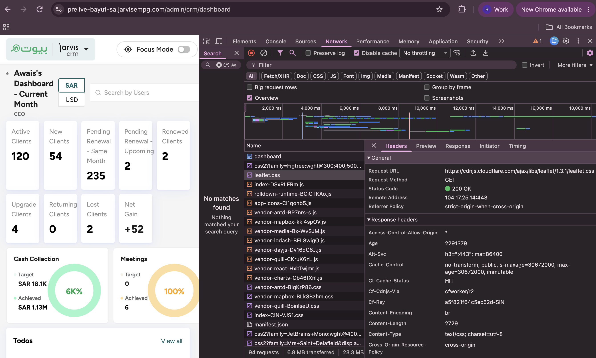
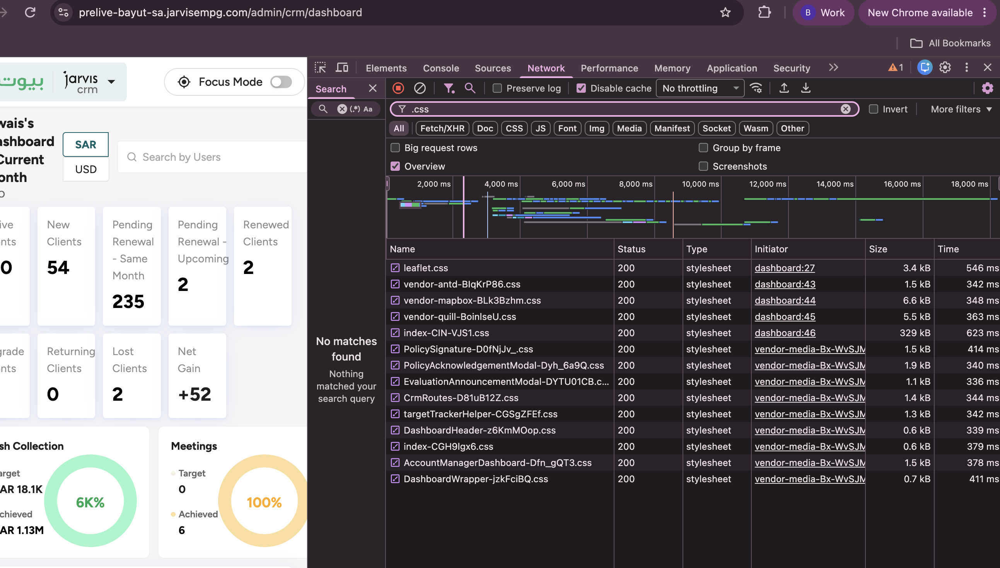
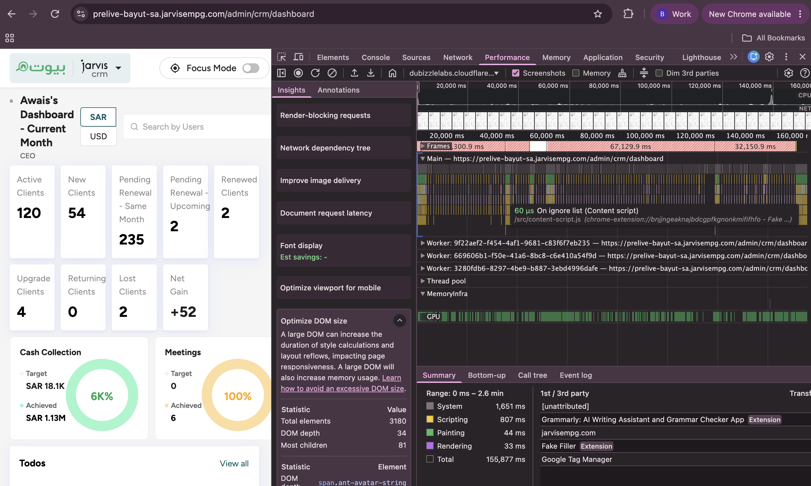
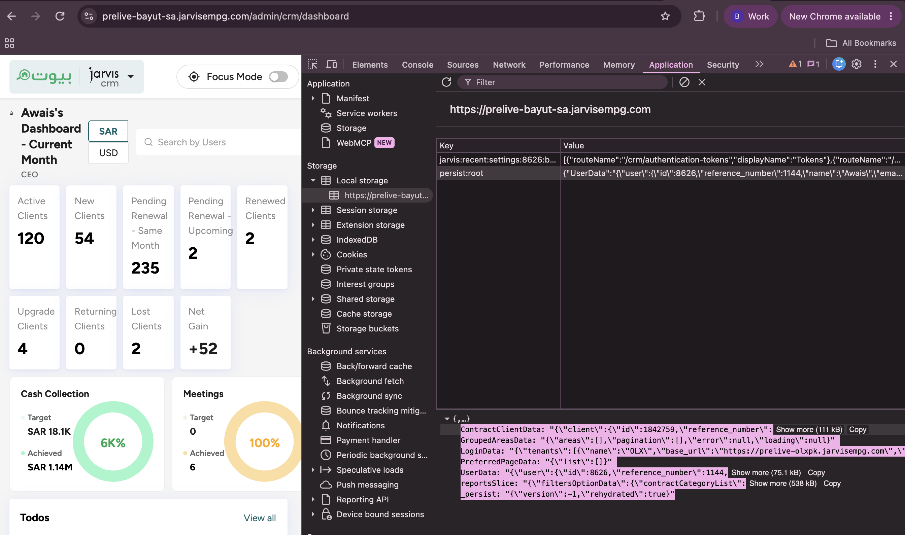
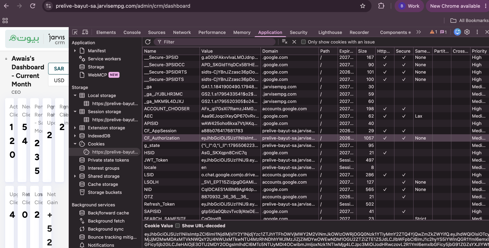

# What Happens When I Open Our App's URL?

When opening the  app's login URL, the browser first finds the server using DNS and creates a secure HTTPS connection.

- Browser resolves the domain using DNS.
- Establishes a secure HTTPS connection.
- Sends an HTTP request to the server.
- Downloads HTML, CSS, JavaScript, and other assets.
- Parses HTML (DOM) and CSS (CSSOM).
- Processes JavaScript and calculates layout.
- Paints and renders the page.
- Loads cookies and browser storage data.
- Performance trace records loading, scripting, and rendering.
- View Page Source vs. Elements reveals whether HTML is server-rendered or client-rendered.

---

## HTTP Request and Assets

Sends an HTTP request and downloads HTML, CSS, JavaScript, and other assets: 94 requests, 6.8 MB transferred.

## Render-Blocking CSS

Stylesheets linked from the HTML block rendering; the heaviest is `index-CIN-VJS1.css` (329 kB, 623 ms).

## Performance Trace

Records loading, scripting, and rendering: scripting 807 ms, painting 44 ms, rendering 33 ms, DOM of 3,180 elements.

## Browser Storage

Loads browser storage data: local storage keeps `persist:root` (app state) and recent settings.

## Cookies

Loads cookies: `JWT_Token`, `Refresh_Token`, `CF_Authorization` and analytics cookies.

## View Page Source vs. Elements

Reveals whether HTML is server-rendered or client-rendered. *(Screenshot to add.)*
